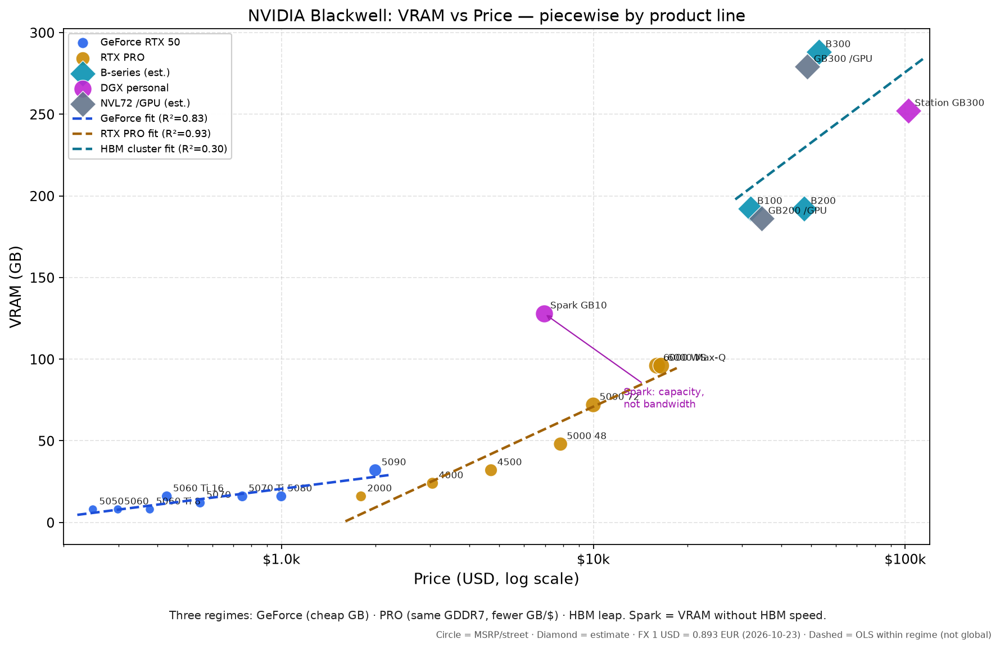
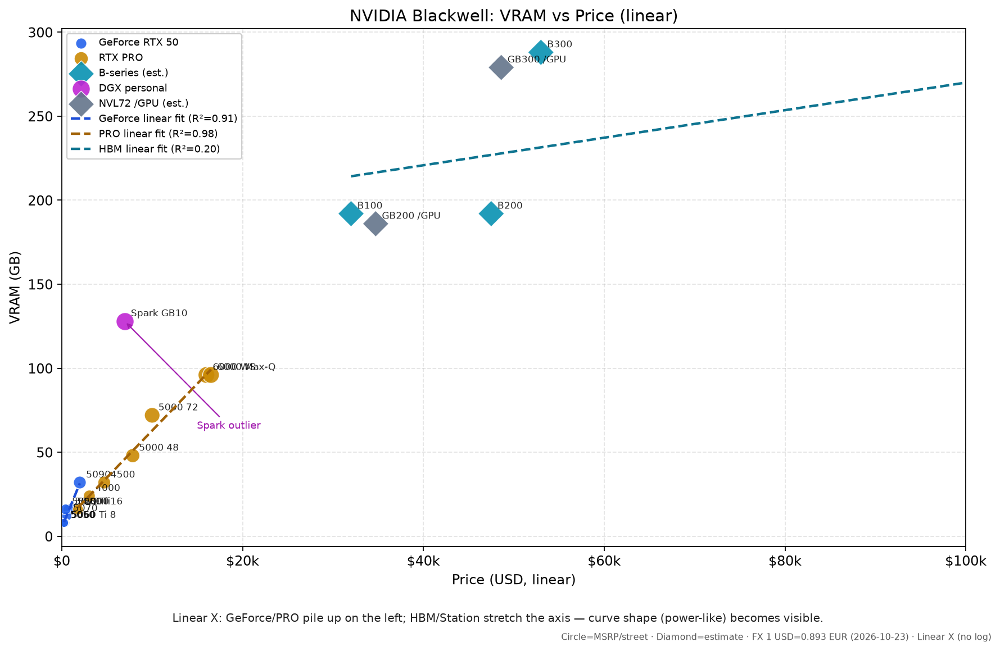
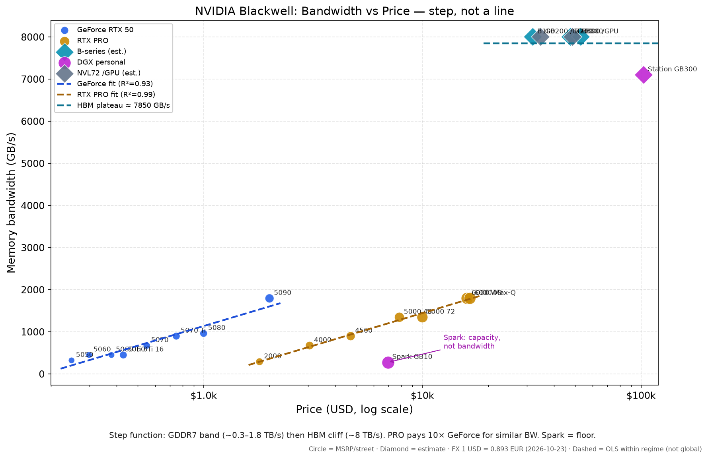
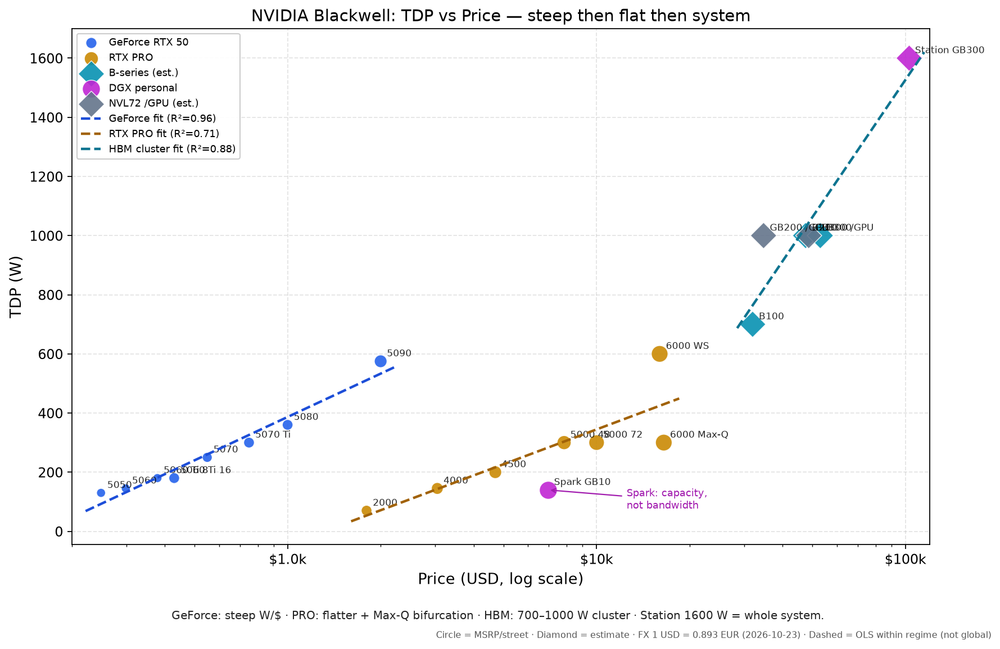
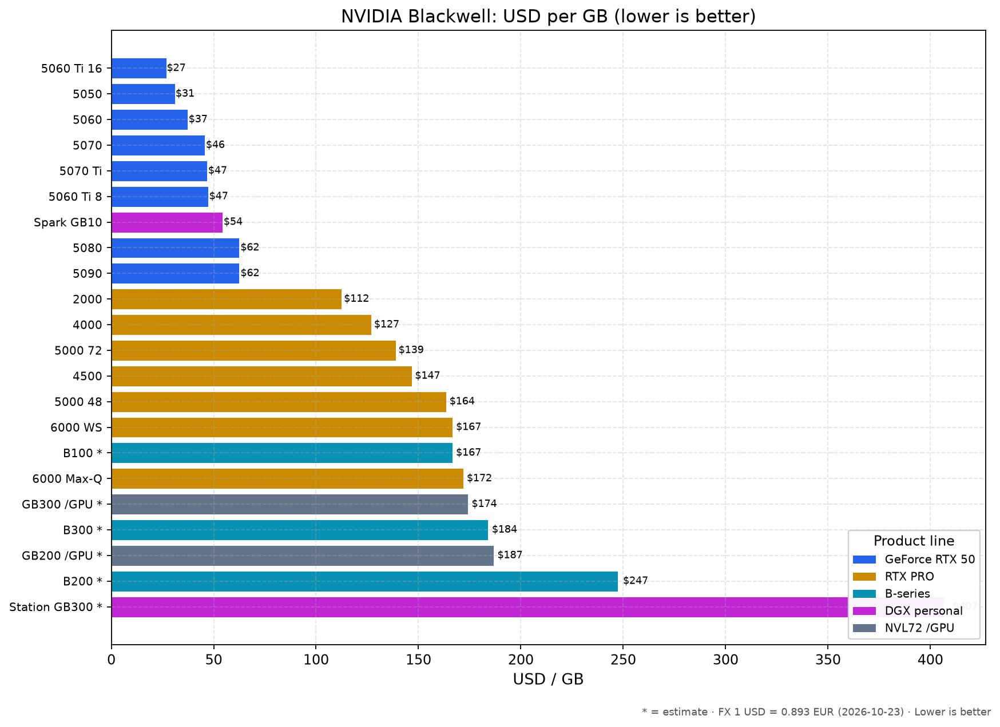
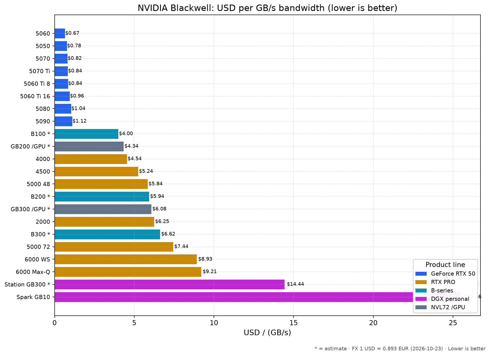
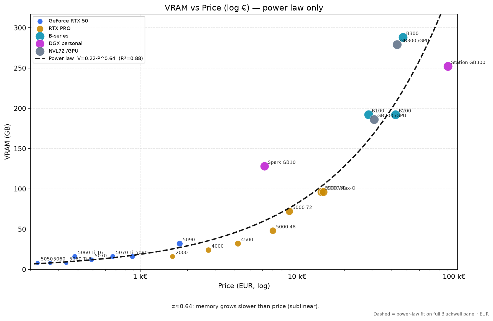
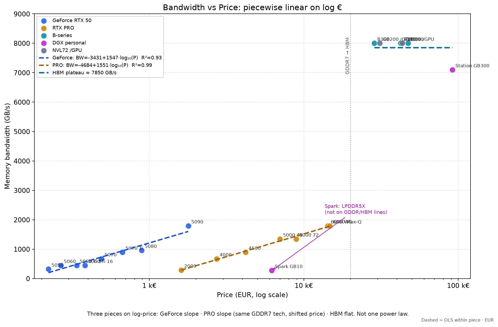

## Objectifs

Il lit une grille de prix Blackwell sans prendre une estimation pour un prix de liste. À la fin, il relie le prix, la VRAM et la bande passante, et il dit ce qu'un R² autorise à conclure.

## Prérequis

Il sait ce qu'est un gigaoctet de mémoire GPU et une bande passante en gigaoctets par seconde. La page [Anatomie d'un nœud Linux et GPU](../m01-anatomie-noeud/) suffit. Il n'achète rien dans cet exercice.

## Notes de cours

La grille date du 23 octobre 2026. Le change retenu dans `rapport-blackwell-prix-20261023.md` est 1 dollar pour 0,893 euro. Les prix américains sans TVA séparée sont traités comme hors taxe après conversion. Une ligne marquée estimation n'est pas un prix NVIDIA affiché.

Les graphiques publiés sont ceux du dossier du 23 octobre 2026. `analyses/blackwell/make_charts.py`, `make_charts_regimes.py` et `make_charts_trends.py` retracent la même table. Une exécution nouvelle peut changer les pixels, selon la version de matplotlib, sans changer les données. Plusieurs fits sont en dollars, parce que ces scripts convertissent le prix euro avant la régression. Le fichier le dit. Il ne faut pas lire un coefficient en dollars comme un coefficient en euros. Le point Station de ces graphiques est l'estimation 91 532 euros du rapport. Il n'efface pas les deux autres prix, réunis dans [Machines d'inférence locale](../m16-machines/).

## Grille de prix

Le tableau suivant reprend `rapport-blackwell-prix-20261023.md`. Les prix sont en euros HT.

| Modèle | Euros HT | Type | VRAM Go | Go/s |
| --- | ---: | --- | ---: | ---: |
| RTX 5090 | 1 785 | MSRP | 32 | 1 792 |
| RTX 5080 | 892 | MSRP | 16 | 960 |
| RTX 5070 Ti | 669 | MSRP | 16 | 896 |
| RTX 5070 | 490 | MSRP | 12 | 672 |
| RTX 5060 Ti 16 Go | 383 | MSRP | 16 | 448 |
| RTX 5060 Ti 8 Go | 338 | MSRP | 8 | 448 |
| RTX 5060 | 267 | MSRP | 8 | 448 |
| RTX 5050 | 222 | MSRP | 8 | 320 |
| PRO 6000 WS | 14 288 | marché | 96 | 1 792 |
| PRO 6000 Max-Q | 14 734 | street | 96 | 1 792 |
| PRO 5000 72 Go | 8 929 | street | 72 | 1 344 |
| PRO 5000 48 Go | 7 009 | street | 48 | 1 344 |
| PRO 4500 | 4 196 | street | 32 | 896 |
| PRO 4000 | 2 723 | street | 24 | 672 |
| PRO 2000 | 1 607 | street | 16 | 288 |
| B100 | 28 576 | estimation | 192 | 8 000 |
| B200 | 42 418 | estimation | 192 | 8 000 |
| B300 | 47 329 | estimation | 288 | 8 000 |
| DGX Spark GB10 | 6 206 | marché | 128 | 273 |
| DGX Station GB300 | 91 532 | estimation | 252 | 7 100 |
| GB200 NVL72 par GPU | 31 007 | estimation | 186 | 8 000 |
| GB300 NVL72 par GPU | 43 410 | estimation | 279 | 8 000 |

Le TDP du rapport va de 70 W pour la PRO 2000 à 1 600 W pour la Station, en passant par 575 W pour la 5090, 600 W pour la PRO 6000 WS, 300 W pour la Max-Q, 1 000 W pour le B200 et 140 W pour le SoC du Spark. Les systèmes Spark et Station ne sont pas des GPU nus. Pour la Station, la VRAM du graphique est les 252 Go de HBM3e, pas les 748 Go de mémoire cohérente.

La bande passante des B-series est le plafond annoncé de 8 000 Go/s. Les sources de specs et de prix sont celles du rapport du 23 octobre 2026, dont NVIDIA, Newegg le 23 octobre 2026, et tech-insider.org au 13 octobre 2026 pour le B200, le B300 et la Station.

Ce rapport estime la Station à 91 532 euros HT. Deux autres fichiers donnent d'autres prix. Ils sont réunis, sans choix, dans [Machines d'inférence locale](../m16-machines/).

## Euros par gigaoctet

Même rapport, mêmes modèles. La colonne de droite est le prix divisé par la bande passante, en euros par gigaoctet par seconde.

| Modèle | Euros par Go | Euros par Go/s |
| --- | ---: | ---: |
| RTX 5090 | 55,8 | 1,00 |
| RTX 5080 | 55,8 | 0,93 |
| RTX 5070 Ti | 41,8 | 0,75 |
| RTX 5070 | 40,8 | 0,73 |
| RTX 5060 Ti 16 Go | 23,9 | 0,85 |
| RTX 5060 Ti 8 Go | 42,2 | 0,75 |
| RTX 5060 | 33,4 | 0,60 |
| RTX 5050 | 27,8 | 0,69 |
| PRO 6000 WS | 148,8 | 7,97 |
| PRO 6000 Max-Q | 153,5 | 8,22 |
| PRO 5000 72 Go | 124,0 | 6,64 |
| PRO 5000 48 Go | 146,0 | 5,22 |
| PRO 4500 | 131,1 | 4,68 |
| PRO 4000 | 113,5 | 4,05 |
| PRO 2000 | 100,4 | 5,58 |
| B100 | 148,8 | 3,57 |
| B200 | 220,9 | 5,30 |
| B300 | 164,3 | 5,92 |
| DGX Spark GB10 | 48,5 | 22,73 |
| DGX Station GB300 | 363,2 | 12,89 |
| GB200 NVL72 par GPU | 166,7 | 3,88 |
| GB300 NVL72 par GPU | 155,6 | 5,43 |

Le rapport résume ainsi la grille. Les GeForce tombent autour de 24 à 56 euros par Go au MSRP. Les RTX PRO tombent autour de 100 à 154 euros par Go. Le B200 est autour de 221 euros par Go. Le Spark est à 48,5 euros par Go, mais à 22,73 euros par gigaoctet par seconde, à cause des 273 Go/s de LPDDR5X. La Station, système compris, est autour de 363 euros par Go.

Le fichier `usd-per-gb-equations.md` ajuste le prix par gigaoctet en dollars. La loi de puissance globale y est 4,8002 fois P puissance 0,359, avec un R² de 0,817. Par régime, le même fichier donne une droite en logarithme du prix, une droite linéaire, et une puissance. En GeForce, la pente lue dans `BRIEF-cloud-interpret.md` est d'environ 37 dollars par Go et par décade de prix. En PRO, elle est d'environ 55. La pente HBM d'environ 456 est tirée par la Station sur une demi-décade. L'ordonnée à l'origine d'environ moins 1 910 dollars par Go n'est pas un coût réel.

## Tendances et régimes

`alpha-refit-by-regime-20261023.md` refait l'exposant de la VRAM sur le prix en euros. `SYNTHESE.md` le résume sans le recalculer. Multiplier le prix par dix ne multiplie la mémoire que par environ 4,4 sur la moyenne du panel, avec V proche de 0,224 fois P puissance 0,641.

| Panel | n | Exposant | R² |
| --- | ---: | ---: | ---: |
| Tous | 22 | 0,641 | 0,878 |
| Sans Spark ni Station | 20 | 0,649 | 0,930 |
| GeForce | 8 | 0,652 | 0,899 |
| PRO | 7 | 0,832 | 0,987 |
| HBM avec Station | 6 | 0,281 | 0,259 |
| HBM sans Station | 5 | 0,744 | 0,586 |

`trend-equations.md` donne des droites globales en dollars, Y égal a plus b fois le logarithme décimal du prix. La VRAM a un R² de 0,785. La bande passante a un R² de 0,657. Le prix par gigaoctet a un R² de 0,747. Le TDP a un R² de 0,621. Ce sont des fits d'ensemble. Ils lissent des régimes différents.

`regime-analysis.md` sépare les régimes, toujours sur le prix en dollars dans le script. La bande passante GeForce vaut environ moins 3 507 plus 1 548 fois le logarithme du prix, R² 0,93, sur 8 cartes. La bande passante PRO vaut environ moins 4 760 plus 1 551 fois le logarithme, R² 0,99, sur 7 cartes. La pente est donc la même, environ 1,55 To/s par décade de prix. Le HBM ne suit pas cette droite. `BRIEF-cloud-interpret.md` place un plateau vers 7 850 Go/s.

Le TDP GeForce, dans le même fichier de régimes, a un R² de 0,96. Le TDP PRO a un R² de 0,71. Le TDP HBM a un R² de 0,88.

`vram-price-alpha-blackwell-20261023.md`, avec les notes du 23 et du 24 octobre 2026, refuse de lire l'exposant 0,64 comme une loi du silicium. La GDDR7 est une DRAM soudée sur la carte, sans TSV ni interposeur. Le HBM3E est un empilement de dies reliés par TSV, posé sur un interposeur CoWoS. Un die défectueux perd le stack. Le modèle de coût d'un B200 cité par Epoch le 10 décembre 2025, et rapporté dans cette note, met environ 2 900 dollars de HBM, 1 100 dollars de CoWoS et 1 000 dollars de rebut, pour un coût variable d'environ 6 250 dollars. Epoch indique aussi, le 21 mai 2026, que le HBM est passé de 52 pour cent à 63 pour cent du coût des composants des puces d'IA. TrendForce, le 29 septembre 2026, dit qu'un stack 8-Hi coûte 10 à 20 pour cent de plus par gigabit qu'un stack 12-Hi. La hausse n'est donc pas une fonction continue de la capacité.

Les autres graphiques du dossier restent dans `analyses/blackwell/`. Le nom dit la grandeur et l'échelle. `log` est un axe de prix logarithmique. `linear` est un axe linéaire.

## Lecture des courbes

Le rapport complet d'interprétation des courbes n'est pas dans le dépôt. Il s'agit d'un résumé uniquement, rapport complet manquant.

Le fichier présent est `RESUME-interpretations-blackwell-curves.md`. Il reprend ce qui a été relayé les 23 et 24 octobre 2026. L'agent visé était `bc-0efe6ed0-9e71-51b2-9f3c-ec6fb21f23d6`. Le brief envoyé est `BRIEF-cloud-interpret.md`.

Le résumé dit ceci. L'exposant n'est pas une loi du silicium. C'est l'élasticité de la grille du 23 octobre 2026. En GeForce, il vaut environ 0,65. En PRO, environ 0,83, avec un R² proche de 0,99. Sur le HBM avec la Station, le R² proche de 0,26 interdit de citer l'exposant. L'exposant du prix par gigaoctet est 1 moins l'exposant de la VRAM. Ce n'est pas un second résultat. Le plateau d'environ 7 850 Go/s est une moyenne HBM. Le packaging décale le niveau de prix du HBM. Il ne fabrique pas le chiffre 0,65.

`NOTES-chat-R2-et-fabrication.md` dit comment lire le R². Un R² de 0,90 veut dire que le prix explique neuf dixièmes des écarts de VRAM. Un R² proche de 0 veut dire que le prix n'aide presque pas. Un R² négatif voudrait dire que le modèle fait pire qu'une moyenne. Une droite de Y contre le logarithme du prix est une logarithmique, pas une puissance. Une puissance est une droite sur un graphe logarithme contre logarithme. C'est le fit global de la VRAM. La bande passante, elle, est linéaire par morceaux sur le logarithme du prix, plus le plateau HBM.

## Exercices

### Exercice 1

Il nomme, dans la grille, la famille au plus bas euros par Go et la ligne au plus haut. Il recopie les deux nombres et le type de prix.

### Exercice 2

Il explique pourquoi le Spark peut être bon marché au gigaoctet et cher à la bande passante. Il cite les 273 Go/s et les 22,73 euros.

### Exercice 3

Il dit, sans nouveau calcul, ce qu'un prix multiplié par dix fait à la VRAM du panel complet. Il nomme le R² de ce fit.

### Exercice 4

Il écrit la phrase exacte qui dit que le rapport d'interprétation est un résumé et que le rapport complet manque.

## Projet solo

Il rédige une note d'une page. La note sépare les prix MSRP, les prix de rue et les estimations. Elle dit pourquoi l'exposant HBM avec la Station n'est pas citable. Elle ne choisit pas un prix de Station.

## Projet de groupe

À deux, l'un lit les fits en euros, l'autre les fits en dollars. Ils marquent, pour trois coefficients, la monnaie de l'axe des prix. Ils rendent ce tableau, pas une nouvelle régression.

## Examen

### Question 1

Quel change dollar euro le rapport du 23 octobre 2026 utilise-t-il ?

### Question 2

Le R² de 0,259 empêche-t-il de citer l'exposant HBM avec la Station, et pour quelle raison ?

### Question 3

Quelle différence le résumé fait-il entre une droite en logarithme du prix et une loi de puissance ?

## Sources

`rapport-blackwell-prix-20261023.md`, 23 octobre 2026.

`alpha-refit-by-regime-20261023.md`, `regime-analysis.md`, `trend-equations.md`, `usd-per-gb-equations.md`, `BRIEF-cloud-interpret.md`.

`vram-price-alpha-blackwell-20261023.md`.

`RESUME-interpretations-blackwell-curves.md` et `NOTES-chat-R2-et-fabrication.md`, 23 et 24 octobre 2026.

`SYNTHESE.md`, octobre 2026, qui cite ces fichiers sans les recalculer.

Les recherches brutes du même jour ont nourri la note sur l'exposant. Elles ne sont pas recopiées.
