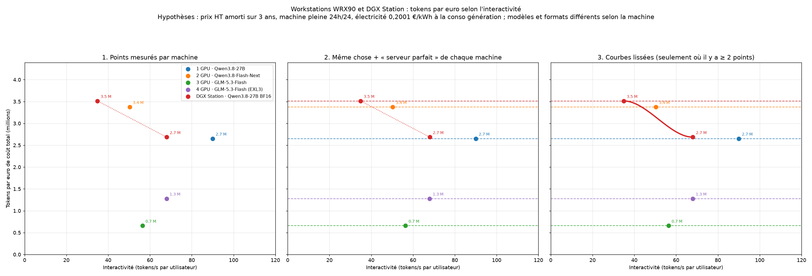
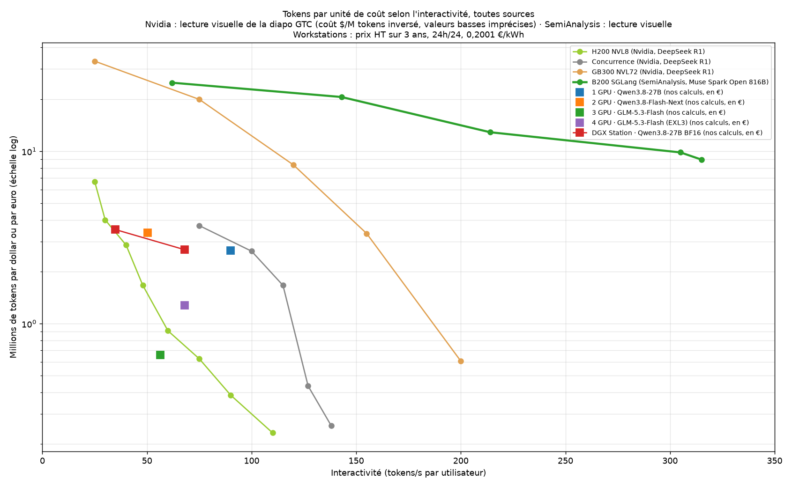

## Objectifs

Il compare des machines d'inférence sans additionner des bancs qui n'ont ni le même modèle, ni le même moteur, ni le même prompt. À la fin, il sépare le decode du prefill, et il sait que la DGX Station a trois prix hors taxe.

## Prérequis

Il a lu [Prix des GPU Blackwell](../m15-blackwell/). Il sait qu'un tok/s agrégé n'est pas un tok/s par utilisateur.

## Notes de cours

Les chiffres viennent des notes d'octobre 2026 nommées en bas de page. Une estimation reste une estimation. Un chiffre rapporté n'a pas été relu sur la page d'origine le jour de la note.

Les graphiques de coût sont produits par `analyses/rigs/ws_plot.py`, `combo.py`, `ensemble.py` et `repro.py`. Ils importent `workstation_data.py`, dans le même dossier. `repro.py` demande scipy. Ces scripts tracent la Station avec le prix du tableur. Ils n'en font pas le prix retenu.

## Decode et prefill

Le decode produit un jeton à la fois. Il relit les poids actifs et le cache KV. Il est limité par la bande passante. Un DGX Spark annonce 273 Go/s. Une DGX Station GB300 annonce 7,1 To/s de HBM3e. Le prefill traite le prompt en parallèle. Il réutilise chaque poids lu. Il est limité par le calcul.

`dgx-spark-throughput-entretien-20261007.md` cite le blog NVIDIA du 16 mars 2026. Sur un Spark seul, Qwen3.5 35B-A3B en FP8, le prefill mesuré est 3 080 tok/s et le decode 35,75 tok/s.

Le prefill agrégé reste presque plat quand la concurrence monte, parce que le calcul est déjà saturé. Le rapport du 22 octobre 2026, d'après rhys101 le 14 septembre 2026, donne 4 196 tok/s pour une requête de 32K sur 8 Spark, et 4 236 tok/s pour huit requêtes de 32K. Le temps avant le premier jeton, pour huit fois 32K, y est estimé à 62 s sur 8 Spark et à 11 s sur une Station.

Dès que des experts sont en LPDDR, la Station retombe au lien mesuré entre Grace et le GPU. Sur GLM-5.3, al-engr le 14 septembre 2026 mesure 332 à 346 Go/s effectifs. C'est à peine plus qu'un Spark. Le rapport note aussi des rafales réseau de 150 à 200 gigabits par seconde en prefill.

## Spark et Station

Le rapport `rapport-concurrence-spark-station-20261022.md` compare 8 Spark avec switch et une Station. Aucune source ne mesure les deux machines avec le même harnais, le même modèle et le même prompt. Les facteurs ci-dessous sont ceux de sa conclusion.

Sur DeepSeek V4.1 Flash, avec débordement partiel, le decode de la Station va de 1,3 à 2,7 fois celui de 8 Spark entre 1 et 16 requêtes. Le prefill va à 24 094 tok/s contre 4 196, soit 5,7 fois. Le rapport estime un croisement au jeton vers 32 requêtes, sur un substitut qui tient en HBM, pas sur le checkpoint natif.

Sur GLM-5.3, avec débordement lourd, l'écart de decode va de 1,2 à 1,7 fois. La Station plafonne vers 100 tok/s dès 4 à 8 requêtes. Le prefill du même passage est environ 2,8 fois, pas 5,7.

Sur la classe Qwen 3.5-397B, le rapport lit environ 3 à 4 fois en decode et environ 12 fois en prefill. Les quantifications diffèrent. Le checkpoint FP8 de 406 Go ne tient pas dans les 252 Go de HBM. La mesure Station est une variante NVFP4 qui tient en HBM.

Kimi K2.6 et DeepSeek V4 Pro ne tournent pas proprement sur une seule Station. V4 Pro dépasse même les 748 Go de mémoire cohérente dans l'estimation du rapport.

`dgx-spark-benchmarks-20261007.md`, au 7 octobre 2026, place un Spark seul autour de 13 à 14 tok/s sur un modèle dense de 27 à 32 milliards quantifié, et de 55 à 85 tok/s sur un MoE de 26 à 35 milliards. vLLM y monte à environ 290 à 313 tok/s agrégés à 8 requêtes. La consommation citée est environ 22 à 25 W au repos, 112 à 160 W au mur, pour une alimentation de 240 W.

`dgx-spark-3x-concurrency-cliff-20261007.md` porte sur trois Spark en anneau, sans switch, et sur DeepSeek V4.1 Flash. L'ancre MiaAI est 51 tok/s à un flux. Par utilisateur, la note lit 51, puis 39, puis 22,8 tok/s à 1, 2 et 4 flux. L'agrégé monte encore, de 51 à 85,4. Il n'y a pas d'effondrement agrégé dans la plage mesurée. Le plafond de 4 flux de cette recette est un cap de configuration, pas une chute mesurée.

## Prix de la DGX Station

Trois fichiers donnent trois prix hors taxe. Les trois prix ne concordent pas. Aucun n'est retenu comme le prix du cours.

Le rapport `rapport-concurrence-spark-station-20261022.md`, daté du 22 octobre 2026, compte la Station à environ 90 000 euros HT. Avec ce prix-là, le même rapport compte 8 PGX, le switch et les câbles à environ 38 374 euros HT, soit un rapport d'environ 2,35. Il estime aussi deux Stations à environ 180 000 euros HT en doublant son propre chiffre, sans le réseau. Ce doublement ne s'applique pas aux deux autres prix.

Le tableur des rigs n'est pas dans le dépôt. Ses totaux sont dans `configs-wrx90.csv`. Cette ligne retient 105 000 euros HT et 126 000 euros TTC. `rigs-wrx90-courbes-20261016.md`, le 16 octobre 2026, part de ces 105 000 euros et d'environ 1 080 W mesurés par StorageReview le 14 septembre 2026. Le coût horaire imprimé est 4,212 euros, dont 3,995 d'amortissement et 0,216 d'électricité. Il ne s'applique pas aux deux autres prix. Le CSV, lui, porte 1 600 W d'alimentation pour la Station, pas les 1 080 W de la mesure.

Le rapport `rapport-blackwell-prix-20261023.md`, daté du 23 octobre 2026, estime la Station à 91 532 euros HT. La ligne est marquée estimation, milieu de fourchette. La source citée est IntuitionLabs, 80 000 à 125 000 dollars, au 13 octobre 2026, via tech-insider.org, converti avec 1 dollar pour 0,893 euro. Les 252 Go de ce rapport sont la HBM3e, pas les 748 Go cohérents.

Les graphiques de `analyses/rigs/` tracent la Station avec les 105 000 euros du tableur. Ils illustrent ce fichier. Ils ne tranchent pas.

## Rigs WRX90

Quatre paliers Threadripper WRX90, chiffrés chez PCSpecialist, sont recopiés dans `configs-wrx90.csv`. Les prix HT du fichier sont 22 801,67, 40 924,17, 59 114,17 et 73 075 euros. Les prix TTC sont 27 362, 49 109, 70 937 et 87 690 euros. Les notes arrondissent souvent les HT à 22 802, 40 924, 59 114 et 73 075.

| Palier | Processeur | RAM | Watts génération |
| --- | --- | --- | ---: |
| 1 GPU | 9965WX, 24 cœurs | 128 Go | 550 |
| 2 GPU | 9965WX, 24 cœurs | 256 Go | 800 |
| 3 GPU | 9985WX, 64 cœurs | 256 Go | 1 100 |
| 4 GPU | 9985WX, 64 cœurs | 256 Go | 1 400 |

La RAM au-delà d'un GPU est de la DDR5 6400 ECC. Les GPU sont des RTX PRO 6000 Blackwell Max-Q de 96 Go. Le modèle de service indiqué est Qwen3.8-27B en NVFP4 sur un GPU, puis GLM-5.3-Flash en NVFP4 à partir de trois GPU.

`rigs-wrx90-courbes-20261016.md` amortit le prix HT sur 3 ans à 8 760 heures, machine pleine, plus l'électricité à 0,2001 euro par kWh, tarif de base au 1er août 2026. L'amortissement pèse 88 à 95 pour cent du coût horaire. Le taux d'utilisation compte donc plus que l'électricité. Les coûts horaires imprimés, en estimation, sont 0,978 euro pour un GPU, 1,717 pour deux, 2,470 pour trois et 3,061 pour quatre.

`rigs-concurrence-mac-20261016.md` fixe un plafond là où le débit par utilisateur passe sous environ 20 tok/s. Sur un GPU, Qwen3.8-27B en FP8 avec MTP, le plafond rapporté est environ 96 à 128 utilisateurs. Sur quatre GPU, GLM-5.3-Flash sous vLLM, le plafond est environ 24, par interpolation entre 8 et 32 requêtes. Ce sont des estimations ou des chiffres rapportés, pas une même campagne.

## Mac Studio

`mac-studio-m5-ultra-entretien-20261007.md`, au 7 octobre 2026, constate que le Mac Studio M5 Ultra est en vente. Annonce Apple du 25 août 2026, magasins le 22 septembre 2026. Il n'existe pas de modèle nommé M5 Ultra Max. Apple a sauté le M4 Ultra.

La fiche lue ce jour-là donne, pour le M5 Ultra, jusqu'à 36 cœurs CPU et 80 cœurs GPU, 96, 256 ou 512 Go unifiés, 1,2 To/s, à partir de 5 499 dollars, et 480 W en continu. L'expédition du 512 Go n'était pas confirmée au 7 octobre. Les bancs ci-dessous sont un M5 Ultra de 256 Go.

NetworkChuck, MLX, 20 septembre 2026, médiane de 5 runs, prompt d'environ 32K, 128 jetons en sortie.

| Modèle | Prefill tok/s | Génération tok/s |
| --- | ---: | ---: |
| Qwen3 14B, 4 bits | 2 278 | 55,4 |
| Qwen3.8 27B, 4 bits | 1 526 | 42,6 |
| Gemma 4 31B, bf16 | 1 217 | 13,6 |
| Qwen3.6 35B-A3B, 4 bits | 6 012 | 109,1 |
| Qwen3.5 122B-A10B, 4 bits | 2 300 | 65,3 |

`mlx_lm.benchmark` donne 67 tok/s pour le 14B et 47,6 pour le 27B. MacStories, le 21 septembre 2026, place Flash-Next au-dessus de 100 tok/s sur des prompts courts, et entre 60 et 85 avec 64K à 256K, jusqu'à 3 sessions dans 256 Go. Ces moteurs et ces quantifications ne sont pas ceux du Spark. La note le dit.

## Concurrence et débit

Trois lectures ne se mélangent pas.

Le débit agrégé peut monter pendant que le débit par utilisateur baisse. Sur trois Spark, MiaAI, le passage de 1 à 4 flux fait passer l'agrégé de 51 à 85,4 tok/s et le flux de 51 à 22,8.

Le plafond d'environ 20 tok/s par utilisateur, dans la note du 16 octobre 2026, n'est pas un seuil NVIDIA. C'est le critère de cette note pour dire qu'un chat reste lisible.

Le prefill et le decode n'ont pas la même limite. Un gain de prefill, comme le facteur 5,7 sur V4.1 Flash, ne se recopie pas sur le decode.

## Bruit

`bruit-configs-wrx90.md`, le 15 octobre 2026, estime le bruit à environ un mètre, en charge d'inférence soutenue. Ce sont des plages, pas une mesure de la machine assemblée. Le Max-Q n'a pas de dBA publié.

| Palier | Plage estimée | Ce qui domine |
| --- | --- | --- |
| 1 GPU | 38 à 46 dBA | alimentation FSP souvent sous 15 dBA vers 550 W |
| 2 GPU | 48 à 55 dBA | Corsair WS3000, environ 44 à 55 dBA selon la charge |
| 3 GPU | 50 à 56 dBA | la même alimentation |
| 4 GPU | 52 à 58 dBA | la même alimentation, vers 51 à 53 dBA |

Dès deux GPU, la WS3000 domine le budget sonore mesuré. La note ne donne pas de chiffre pour la Station. Le CSV laisse cette case vide. Aucun chiffre n'est ajouté ici.

## Exercices

### Exercice 1

Il explique, en trois phrases, pourquoi le prefill peut rester plat quand on passe d'une requête de 32K à huit requêtes de 32K sur 8 Spark. Il recopie les deux débits du rapport.

### Exercice 2

Il recopie les trois prix HT de la Station, le nom du fichier de chacun, et la phrase qui dit qu'ils ne concordent pas.

### Exercice 3

Il dit ce qui arrive au débit par utilisateur sur trois Spark entre 1 et 4 flux, et ce qui arrive au débit agrégé. Il ne parle pas d'effondrement agrégé.

### Exercice 4

Il choisit un palier WRX90 et il dit si la plage de bruit est une mesure de la machine ou une estimation. Il cite la date de la note.

## Projet solo

Il rédige une page. La page dit pour quel modèle du rapport du 22 octobre 2026 une Station gagne en prefill, et pour lequel le decode mesuré reste sous le rapport de prix de ce même rapport. Il ne choisit pas un prix parmi les trois.

## Projet de groupe

À deux, l'un lit les bancs Mac Studio, l'autre les bancs Spark. Ils marquent, pour deux paires de chiffres, que le moteur et la quantification diffèrent. Ils ne déclarent pas un gagnant.

## Examen

### Question 1

Quel fichier du 22 octobre 2026 porte le prix d'environ 90 000 euros HT, et quels sont les deux autres prix avec leur fichier ?

### Question 2

Un débit agrégé qui monte peut-il quand même gâcher le chat ?

### Question 3

Pourquoi la note de bruit ne donne-t-elle pas un niveau pour la Station ?

## Sources

`rapport-concurrence-spark-station-20261022.md`, 22 octobre 2026.

`dgx-spark-throughput-entretien-20261007.md`, `dgx-spark-benchmarks-20261007.md`, `dgx-spark-3x-concurrency-cliff-20261007.md`, `mac-studio-m5-ultra-entretien-20261007.md`, 7 octobre 2026.

`rigs-wrx90-courbes-20261016.md` et `rigs-concurrence-mac-20261016.md`, 16 octobre 2026.

`bruit-configs-wrx90.md`, 15 octobre 2026.

`configs-wrx90.csv`, totaux du tableur non publié.

`rapport-blackwell-prix-20261023.md`, 23 octobre 2026.

`SYNTHESE.md`, octobre 2026, qui cite ces fichiers sans les recalculer.

Les recherches brutes du dossier ne sont pas recopiées.
